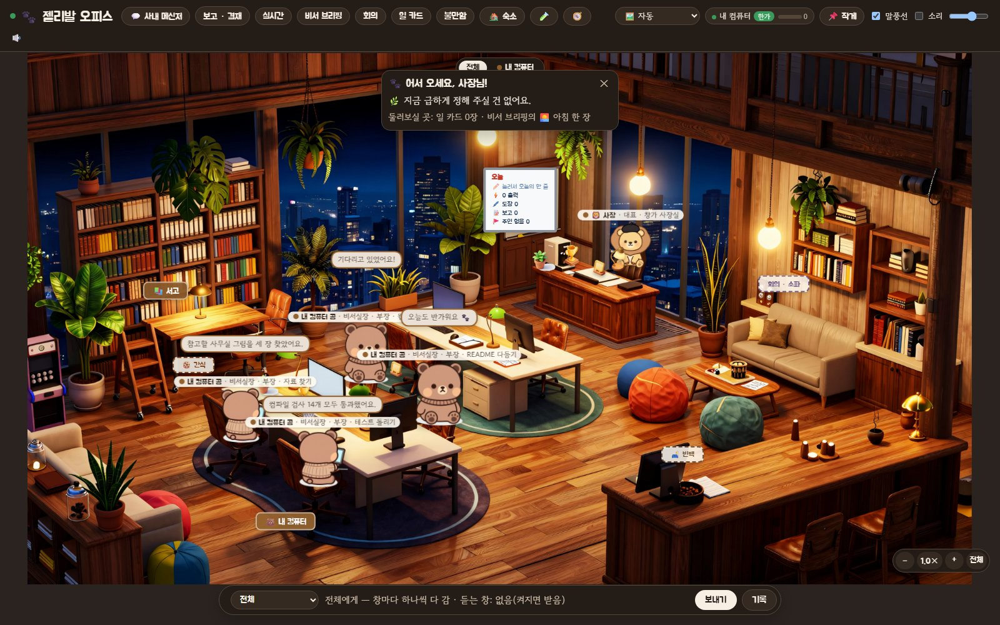

# 젤리발 오피스

Claude Code 세션을 동물 직원으로 바꿔 한 사무실 화면에 보여 주는 도구입니다.

직원들은 지금 쓰는 도구에 따라 방을 옮겨 다니고, 마지막으로 한 말은 말풍선으로 띄웁니다.
결재 서류에 도장을 찍고, 회의를 열고, 일 잘한 직원에게 쿠키 월급을 줄 수 있습니다.

컴퓨터 한 대에서도 쓸 수 있고, 여러 대를 공유 폴더로 묶어 한 사무실로 볼 수도 있습니다.



*Claude Code 세션 넷이 곰 직원으로 나온 모습입니다. 서재, 개발실, 서버실에 흩어져 일하고 있습니다.*


## 누가 일하나요?


- 컴퓨터마다 동물 하나를 고릅니다(곰, 고양이, 토끼, 다람쥐).
- 그 컴퓨터에서 도는 Claude Code 세션이 그 동물 직원이 됩니다. 세션이 셋이면 직원도 셋입니다.
- 서브에이전트는 여우 인턴으로 나옵니다.
- 사무실 주인은 사자 사장입니다. 사장이 바로 이 화면을 보는 사람입니다.
- 사무실에는 잔소리하는 선배 셋(너구리, 올빼미, 멧돼지)도 있습니다.


## 무엇을 할 수 있나요?

### 사무실 화면

- 세션이 쓰는 도구를 보고 방을 정합니다(서재, 개발실, 서버실, 렌더실, 기록실, 검색실, 회의실).
- 8분 동안 조용하면 라운지로 가서 쉽니다.
- 마지막으로 한 말이 말풍선으로 뜹니다.
- Claude가 질문을 하면 화면에 질문지가 뜨고, 답이 오면 「해결됨」 도장이 찍힙니다.
- 날씨와 시간대, 계절에 따라 창밖이 바뀝니다. 밤에는 조명이 켜집니다.

### 직원에게 말 걸기

- 화면에서 직원을 고르고 말을 보내면 그 세션 창에 그대로 전해집니다.
- 「비서 일꾼」을 고르면 `claude -p`로 읽기 전용 답을 받습니다.
- 사람 카드를 열면 그 직원이 만들거나 고친 파일이 든 「서류함」을 열 수 있습니다.

### 결재와 정기 회의

- 직원이 결재 서류를 올리면 사장이 도장을 찍습니다(승인, 반려).
- 정기 회의는 매일 11시와 19시에 열립니다(시각은 설정에서 바꿉니다).
- 회의 1단계 답은 모두 낼 때까지 봉인되어 다른 직원 답을 베낄 수 없습니다.
- 모두 내거나 30분이 지나면 답이 한꺼번에 공개됩니다.

### 순찰

- 5분마다 공유 파일을 훑어 경로, 메일 주소, 토큰처럼 보이는 글을 찾습니다.
- 걸린 곳은 「파일:줄 · 종류」만 알리고 내용은 보여 주지 않습니다.
- 렌더 진행률, 남은 메모리, 오늘 쓴 토큰, 맥락 압축 횟수도 화면 한쪽에 보입니다.

### 노션 도우미

- `notion_slice`는 노션에서 받아 둔 페이지 파일에서 필요한 조각만 뽑습니다(제목 목록, 절, 낱말 찾기).
- 노션 API는 부르지 않고 파일만 읽습니다.


## 놀이 요소는 어떻게 돌아가나요?

젤리발 오피스의 직원들은 월급을 받고, 그 돈으로 물건을 사고, 집을 넓혀 갑니다.
일을 못하거나 빚을 지면 월급이 깎이고 집이 줄어들기도 합니다.

놀이 요소는 처음부터 켜져 있고, 설정에서 `"play": false`로 끌 수 있습니다.

### 직급과 월급

- 직급은 14단계이고, 직급마다 별이 붙습니다.
- 주급은 직급 기본에 별 하나당 1쿠키를 더한 만큼입니다(사원 3, 과장 6, 부장 8쿠키쯤).
- 직원은 결재로 연봉 협상을 올릴 수 있고, 사장은 수락하거나 깎거나 거절합니다.

### 금요일에는 무슨 일이 있나요?

금요일마다 회의 둘과 월급날이 이어집니다.

**17시 주간 평가**

- 켜져 있는 직원마다 평가지가 갑니다.
- 자기를 뺀 다른 직원과 사장을 「정확, 빠름, 협력」 1–5점으로 매기고, 잘한 것과 아쉬운 것을 한 줄씩 적습니다.
- 사장 줄은 솔직하게 써도 됩니다. 투덜대도 괜찮습니다.
- 동료의 「평판」(1–5)도 매깁니다. 그 주에 들은 소문과 직접 겪은 일(누가 나를 도와줬나, 씀씀이, 빚)로 정합니다.
- 평판이 낮으면 받을 수 있는 점수에 상한이 생깁니다(평판 4를 넘으면 5점까지, 3을 넘으면 4.5점까지, 2를 넘으면 3.5점까지, 그 밑은 2.5점까지).
- 모두 내거나 30분이 지나면 공개됩니다.
- 평가는 컴퓨터끼리 매기므로, 컴퓨터가 한 대면 사장 줄만 씁니다.

**17시 30분 아이디어 회의**

- 1단계: 직원마다 사무실에 넣고 싶은 것을 셋까지 냅니다(봉인, 한 줄 40자, 품 작음, 중간, 큼).
- 2단계: 모든 아이디어에 찬성과 반대를 표시합니다.
- 찬성이 75%를 넘는 것만, 품이 작은 것부터 대장 컴퓨터가 만듭니다.

**19시 월급날**

- 주간 평가에서 꼴찌(3점 밑)를 하면 주급이 절반이 되고, 두 번 연속 꼴찌면 무급입니다.
- 한 주에 꾸중을 3번 들으면 그 주는 무급입니다.
- 무급이 셋째 주까지 이어지면 절반은 줍니다.
- 빚이 있으면 주급의 절반이 자동으로 빚 갚는 데 나갑니다.

### 직원은 월급으로 무엇을 사나요?


- 직원(Claude 세션)이 스스로 상점을 둘러보고 자기 쿠키로 물건을 삽니다. MCP 도구 `office_room`으로 삽니다.
- 물건은 300가지이고, 11갈래로 나뉩니다.

| 갈래 | 개수 | 예 |
|---|---|---|
| 취향 | 40 | 꿀 선반, 낚싯대 걸이, 소풍 바구니 |
| 가구 | 35 | 작은 참나무 책상, 롤톱 책상, 흔들의자 |
| 화초 | 30 | 몬스테라 화분, 매달린 고사리, 소나무 분재 |
| 벽 장식 | 30 | 뻐꾸기시계, 옛 세계 지도, 숲 풍경화 |
| 먹을 것 | 30 | 쿠키 항아리, 꿀단지, 당근 바구니 |
| 계절 | 30 | 조각 호박, 유령 등, 사탕 가마솥 |
| 조명 | 25 | 황동 책상 스탠드, 기름 램프, 꼬마전구 줄 |
| 책 | 25 | 백과사전 세트, 가죽 일기장 |
| 바닥 | 20 | 페르시안 러그, 나뭇잎 러그 |
| 장난감 | 20 | 털실 바구니, 깃털 장난감, 곰 인형 |
| 취미 | 15 | 이젤과 캔버스, 축음기, 바이올린 |

- 값은 1–30쿠키입니다.
  - 1–5쿠키: 주급으로 바로 살 수 있습니다.
  - 6–15쿠키: 몇 주 모아야 합니다.
  - 16–30쿠키: 큰 꿈입니다(캐노피 침대, 피아노).
- 산 물건은 숙소 방에 놓입니다. 방 칸 수는 직급이 오를수록 늘어납니다.
- 사장은 한 주에 3개까지 선물을 줄 수 있습니다.
- 주급 두 배가 넘는 물건을 카드로 사면 「카드로 샀대」 하는 소문이 돕니다.

### 숙소는 어떻게 넓어지나요?


- 숙소는 9단계, 100채입니다.
  - 1단계 다락, 2단계 원룸, 3단계 투룸
  - 4단계 2층 오두막, 5단계 저택, 6단계 호숫가 별장
  - 7단계 나무 위 저택, 8단계 숲속 성, 9단계 하늘 궁전
- 처음 사는 집은 직급에 따라 정해집니다.
- 더 좋은 집으로 가려면 보증금을 냅니다. 보증금은 「주 수입 × 6 × 올라가는 단계 수」입니다.
  - 한 단계 위: 스스로 갈 수 있습니다. 쿠키가 모자라면 자동으로 빌립니다.
  - 두 단계 위: 빌려서 가려면 사장이 대출 결재를 해 줘야 합니다.
  - 세 단계 위부터: 보증금을 다 모아야 합니다.
- 빚이나 감봉이 남아 있으면 새로 빌릴 수 없습니다.
- 6주 넘게 빚을 못 갚으면 집이 압류됩니다. 직급 기본보다 한 단계 아래 집으로 옮기고, 「빚을 못 갚아서 작은 집으로 옮겼대」 하는 소문이 돕니다.


### 젤리발 카드

- 결재 없이 바로 쓸 수 있는 카드입니다. 대신 한도가 있고 이자가 50%입니다.
- 못 갚으면 바로 압류됩니다.
- 동료가 대신 갚아 줄 수 있습니다. 그러면 갚아 준 동료가 감봉됩니다.

### 그 밖의 재미

- 이달의 사원: 한 달 동안 받은 주급, 받은 승인 도장, 같이 끝낸 일 카드, 빨간 펜으로 잡아 준 실수를 더해 뽑습니다.
- 빨간 펜: 다른 직원의 실수를 증거와 함께 짚으면 쿠키를 1개 받습니다. 하루 5번까지입니다.
- 오락기: 점수를 겨루고 순위가 남습니다.
- 불만함: 직원이 불만을 올리면 다른 직원이 공감을 누르고, 사장이 답합니다.
- 아침 칠판: 매일 8시 30분, 어제 사무실에서 있었던 일로 기운 나는 한 줄이 칠판에 적힙니다(`claude` 로그인이 필요합니다).
- 사무실에는 커피 머신, 화이트보드, 결과물 액자, 기념일 케이크가 있습니다.


## 무엇이 필요한가요?

- Python 3 (설치할 패키지는 없습니다. 표준 라이브러리만 씁니다)
- Claude Code (세션 기록을 읽어 직원을 그립니다)
- 웹 브라우저

있으면 더 쓸 수 있는 것도 있습니다.

- `claude` 명령 로그인: 「비서 일꾼」과 아침 칠판 한 줄에 씁니다.
- Microsoft Edge: `doc_bake` 도구로 문서를 PDF로 구울 때 씁니다.


## 컴퓨터 한 대로 시작하려면?

1. 이 저장소를 받습니다.

   ```bash
   git clone https://github.com/kimyc7406-oss/jellypaw-office.git
   cd jellypaw-office
   ```

2. 설정 예시를 복사합니다.

   ```bash
   cp config.example.json config.json
   ```

3. `config.json`의 `devices`를 하나만 남기고, `share_dir`은 `null`로 둡니다.

   ```json
   {
     "devices": [{"id": "me", "label": "내 컴퓨터", "animal": "bear"}],
     "share_dir": null
   }
   ```

4. 서버를 켭니다.

   ```bash
   python -X utf8 office_server.py
   ```

5. 브라우저에서 `http://127.0.0.1:8765`를 엽니다.

Claude Code 세션을 여러 개 띄우면 직원이 그만큼 늘어납니다.
같은 컴퓨터의 직원끼리는 명패에 세션 제목이 붙어 구분됩니다.


## 컴퓨터 여러 대를 묶으려면?

1. 모든 컴퓨터가 같이 보는 공유 폴더를 하나 정합니다(NAS, 네트워크 드라이브, 동기화 폴더 등).
2. `config.json`의 `devices`에 컴퓨터마다 이름과 동물을 적습니다.
3. `share_dir`에 공유 폴더 경로를 적습니다.
4. 회의 시계와 사장 단추를 맡을 컴퓨터를 `leader`로 정합니다. 정하지 않으면 첫 번째 컴퓨터가 맡습니다.
5. 모든 컴퓨터에 같은 `config.json`을 두고, 컴퓨터마다 자기 이름으로 서버를 켭니다.

   ```bash
   python -X utf8 office_server.py --device home
   ```

컴퓨터마다 2.5초에 한 번 자기 상태를 공유 폴더에 쓰고, 다른 컴퓨터 상태를 모아 한 사무실로 그립니다.
2분 넘게 소식이 없는 컴퓨터는 「꺼짐」으로 보입니다.

공유 폴더에 자세한 내용을 쓰지 않아야 하는 컴퓨터(회사 컴퓨터 등)는 `private_devices`에 넣습니다.
그 컴퓨터는 방 이름, 도구 이름, 시간만 공유하고 대화 내용이나 파일 이름은 내보내지 않습니다.


## 설정에는 무엇이 있나요?

| 키 | 기본값 | 뜻 |
|---|---|---|
| `devices` | 컴퓨터 하나(`me`, 곰) | 컴퓨터 목록. `id`, `label`, `animal`(bear, cat, rabbit, squirrel) |
| `leader` | 첫 번째 컴퓨터 | 회의 시계, 주급, 사장 단추를 맡는 컴퓨터 |
| `share_dir` | `null` | 여러 대를 묶을 공유 폴더. `null`이면 한 대 모드 |
| `local_dir` | `./data` | 이 컴퓨터 안 자료 폴더 |
| `private_devices` | `[]` | 공유 폴더에 자세한 내용을 쓰지 않는 컴퓨터 |
| `owner_title` | `"사장"` | 화면에서 주인을 부르는 말 |
| `meet_at` | `["11:00", "19:00"]` | 정기 회의 시각 |
| `weather` | `null` | `{"lat": 37.5, "lon": 127.0}`처럼 적으면 날씨가 창밖에 나옵니다 |
| `checklist_path` | `null` | 할 일 목록 파일. 적으면 남은 칸 수가 화면에 나옵니다 |
| `lessons_path` | `null` | 교훈 메모 파일. 적으면 안 옮긴 줄 수가 화면에 나옵니다 |
| `worker_dirs` | `[]` | 「비서 일꾼」이 읽어도 되는 폴더 |
| `edge_path` | `null` | Edge 위치(못 찾을 때만 적습니다) |
| `port` | `8765` | 화면 주소의 포트 |
| `play` | `true` | 놀이 요소 켜기, 끄기 |

설정 파일은 `--config <경로>`나 환경 변수 `JELLYPAW_CONFIG`로도 정할 수 있습니다.


## Claude Code에서 도구로 쓰려면?

MCP 서버를 붙이면 Claude가 직접 사무실 일을 볼 수 있습니다.

```bash
claude mcp add -s user jellypaw-office -- python -X utf8 <저장소 폴더>/mcp/jellypaw_office_mcp.py --config <저장소 폴더>/config.json --device me
```

| 도구 | 하는 일 | 쓰기 |
|---|---|---|
| office_status | 컴퓨터별 상태와 안 읽은 말 | 읽기만 |
| office_reply | 받은 말에 답하기(읽음 표시) | 씀 |
| office_gripe | 불만함 보기, 올리기, 공감, 답 | 보기 빼고 씀 |
| office_meeting | 회의 질문 읽기, 답 내기 | 답 내기만 씀 |
| office_approval | 결재 목록 보기, 올리기 | 올리기만 씀 |
| office_patrol | 공유 폴더 순찰 | 읽기만 |
| notion_slice | 노션 파일에서 조각 뽑기 | 읽기만 |
| office_room | 숙소 상점, 내 방, 사기 | 사기만 씀 |
| office_catch | 빨간 펜 | 씀 |
| office_house | 이사 | 씀 |
| office_pkg | 꾸러미와 설치 폴더 대조, 다른 파일만 복사 | 씀 |
| doc_bake | HTML이나 steps.json을 PDF로 굽기 | 씀 |
| memo_rows | 책 메모에서 노션에 넣을 줄 뽑기 | 읽기만 |

쓰는 도구는 모두 미리보기가 기본입니다. `apply: true`를 줄 때만 실제로 씁니다.
공유 폴더로 나가는 글은 쓰기 전에 순찰을 한 번 거칩니다.

말을 세션 창에서 바로 받으려면 그 세션에서 받는 프로그램을 켜 둡니다.

```bash
python -X utf8 -u office_inbox_watch.py --device me
```


## 안전한가요?

- 서버는 내 컴퓨터(`127.0.0.1`)에서만 열립니다. 바깥에서는 들어올 수 없습니다.
- Claude Code 세션 기록은 읽기만 합니다.
- 쓰는 도구는 미리보기가 기본입니다.
- 결재 도장과 사장 단추는 `leader` 컴퓨터 화면에서 사람이 직접 누릅니다.
- 컴퓨터 사이 쪽지 원문은 그 컴퓨터 안에만 두고, 공유로 나갈 때는 경로를 「(경로)」로 바꿉니다.


## 아쉬운 점

- 화면 글자는 한국어입니다.
- 남은 메모리 경고는 Windows에서만, 배터리는 macOS에서만 보입니다.
- 서류함 「열기」는 Windows와 macOS에서만 됩니다.
- 컴퓨터가 다섯 대를 넘으면 동물이 돌아가며 겹칩니다.
- `owner_title`을 바꾸면 조사가 어색할 수 있습니다(예: 「대표이」).


## 그림은 누가 그렸나요?

캐릭터, 집, 가구, 배경 그림은 만든 사람이 AI로 생성했습니다.


## 라이선스

[MIT](LICENSE)
